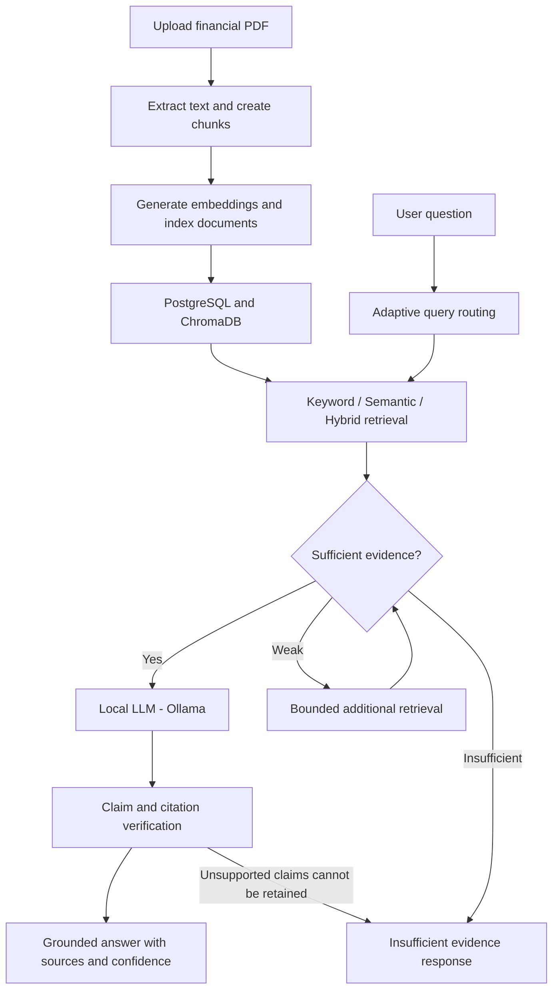

# FinAssist AI

**An evidence-aware AI assistant for financial document analysis.**

FinAssist AI helps users explore financial reports without manually searching through lengthy PDFs. Upload a report, ask questions in natural language, and receive answers backed by document excerpts and page references. The system uses adaptive Retrieval-Augmented Generation (RAG) and checks whether the retrieved evidence supports its answers.

## Features

- **Financial PDF analysis** — upload, index and manage financial reports.
- **Adaptive RAG** — automatically chooses keyword, semantic or hybrid retrieval based on the question.
- **Evidence verification** — checks financial figures, reporting periods and citations; abstains when evidence is insufficient.
- **Explainable answers** — displays source excerpts, page numbers, retrieval strategy and evidence confidence.
- **Document-scoped chat** — ask questions across selected reports and revisit previous conversations.
- **Local AI and secure access** — Ollama-based generation, JWT authentication and user-isolated document storage.

## Screenshots

<!-- Add the four application screenshots to docs/screenshots/ using the filenames below. -->

### Dashboard


### Document Management


### AI Assistant


### Evidence and Source Citations


## Tech Stack

| Layer | Technologies |
| --- | --- |
| Frontend | React, Vite |
| Backend | Python, FastAPI, SQLAlchemy |
| Database | PostgreSQL |
| Vector database | ChromaDB |
| PDF processing | PyMuPDF |
| Embeddings | BGE Small (`BAAI/bge-small-en-v1.5`) |
| Retrieval | BM25, semantic search, Reciprocal Rank Fusion (RRF) |
| Local LLM | Ollama (Qwen) |
| Infrastructure | Docker Compose, Nginx |

## How It Works



## Getting Started

### Prerequisites

- Git
- Docker Desktop with Docker Compose v2
- Ollama installed on Windows

### 1. Clone the repository

```powershell
git clone https://github.com/maithilee17/FinAssist_AI.git
cd FinAssist_AI
```

### 2. Configure the environment

```powershell
if (-not (Test-Path .env)) { Copy-Item .env.example .env }
```

Set a strong random `JWT_SECRET_KEY` and replace the example database password in both `POSTGRES_PASSWORD` and `DATABASE_URL`. Keep `.env` private.

The project uses local Ollama generation. Set the following values in `.env` if using the project's Qwen3 configuration:

```env
LLM_PROVIDER=ollama
OLLAMA_MODEL=qwen3:4b-instruct
```

Install the matching model if it is not already available:

```powershell
ollama pull qwen3:4b-instruct
```

If you choose another local Ollama model, use its exact installed name in `.env` instead. To disable Ollama cloud features, set `OLLAMA_NO_CLOUD=1` in the Ollama server environment and restart Ollama.

### 3. Start the application

Open Docker Desktop and make sure Ollama is available. From the project root, run:

```powershell
.\start.ps1
```

Alternatively, use `./start.sh` in Git Bash on Windows.

| Service | Default URL |
| --- | --- |
| Web application | http://localhost:5173 |
| Backend | http://localhost:8000 |
| API documentation | http://localhost:8000/docs |

For maintenance, use `.\start.ps1 --status`, `.\start.ps1 --logs`, `.\start.ps1 --restart` or `.\start.ps1 --stop`.

## Try It Out

1. Register and sign in to the application.
2. Upload the included [`fictional-financial-report.pdf`](fictional-financial-report.pdf).
3. Wait for the document status to become **Completed**.
4. Open the Assistant and select the uploaded report.
5. Ask a question and inspect the answer's citations.

Example questions:

- What was total revenue in FY2025?
- Compare FY2024 and FY2025 operating profit.
- What risks did management identify?
- What was the debt-to-equity ratio? (Not disclosed in the sample report.)

## Project Structure

```text
FinAssist_AI/
├── backend/              # APIs, retrieval, verification and tests
├── frontend/             # React application
├── docs/                 # Technical documentation
├── reports/              # Project reports
├── scripts/              # Startup utilities
├── docker-compose.yml
├── .env.example
├── start.ps1
├── start.sh
└── README.md
```

## Evaluation and Limitations

A documented benchmark of 16 questions across two official financial reports recorded 87.5% evidence-outcome accuracy and 70% citation-page correctness on answerable cases. LLM answer correctness was not evaluated in that run, so these figures are not overall answer-accuracy guarantees.

Image-only scanned PDFs are not currently supported. Confidence measures evidence quality, not the probability that an answer is correct. FinAssist AI is a document research tool, not a substitute for professional financial advice.

See the [project documentation](docs/) for more information about architecture, security and testing.
