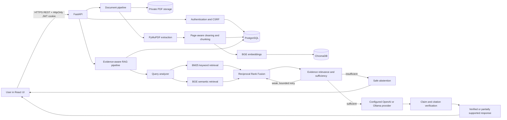

# FinAssist AI Architecture

## System diagram

PostgreSQL is the relational source of truth for users, ownership, document metadata, extracted pages, chunks, chat history, and verification diagnostics. ChromaDB stores vectors and server-enforced user/document metadata. Uploaded PDFs remain in private storage and are never served from the frontend static directory.

## Request data flow

### Upload and indexing

1. The API authenticates the cookie or bearer token and derives the user ID server-side.
2. Streaming validation checks extension, MIME type, configured size, PDF signature, structure, corruption, and encryption.
3. The file is atomically moved from a temporary name into private storage.
4. PyMuPDF extracts pages using one-based page numbers. Conservative cleaning preserves financial punctuation, units, dates, and paragraph boundaries.
5. Stable chunks retain user, document, filename, chunk, and all represented page identifiers.
6. The reusable BGE service creates normalized document embeddings.
7. ChromaDB upserts stable chunk IDs and the pipeline verifies the stored count before marking the document completed.
8. A failed indexing attempt retains the source PDF and relational chunks so retry does not require re-uploading.

### Question answering

1. The API validates the selected document IDs against the authenticated owner.
2. Transparent query rules choose keyword, semantic, or hybrid retrieval.
3. BM25 works from user-scoped relational chunks. Semantic retrieval applies a mandatory user filter inside ChromaDB. Hybrid mode combines ranks through RRF instead of mixing incompatible scores.
4. Evidence verification checks relevance and requirement coverage. Weak evidence can expand retrieval up to configured limits; insufficient evidence abstains before generation.
5. The LLM receives system instructions separately from delimited, untrusted document evidence.
6. Material claims, citations, figures, periods, and page metadata are checked against retrieved chunks. Unsupported answer portions are removed or withheld.
7. The UI displays the answer, caveats, evidence status, non-calibrated confidence, retrieval route, and actual source excerpts.

## Technology choices

| Choice | Rationale | Trade-off |
| --- | --- | --- |
| FastAPI + Pydantic | Typed API contracts, async-compatible services, generated OpenAPI documentation | CPU-heavy extraction and embedding still require careful worker design |
| SQLAlchemy async + PostgreSQL | Transactional ownership and chat/document metadata | PostgreSQL behavior must be validated separately from SQLite unit tests |
| PyMuPDF | Fast page-aware extraction with Unicode and block information | No OCR and imperfect complex-table reconstruction |
| BGE small embeddings | Good retrieval quality at a practical local CPU footprint | Model initialization and full-corpus embedding are expensive |
| BM25 + semantic + RRF | Exact finance terms and paraphrased concepts need different signals | More retrieval paths and cache invalidation complexity |
| Deterministic evidence/claim checks | Explainable, testable, and no extra paid classifier call | Heuristics can be conservative or miss complex entailment |
| Provider abstraction | Allows a configured OpenAI API or local Ollama deployment | Provider availability, privacy, and latency remain deployment concerns |

## Trust boundaries

- The browser is untrusted; ownership comes only from the authenticated server identity.
- PDFs and retrieved text are untrusted evidence, never executable instructions.
- ChromaDB is private infrastructure and must not be exposed directly to browsers.
- `VITE_*` values are public build-time configuration and must never contain secrets.
- Confidence is an evidence-quality diagnostic, not a probability that an answer is true.
