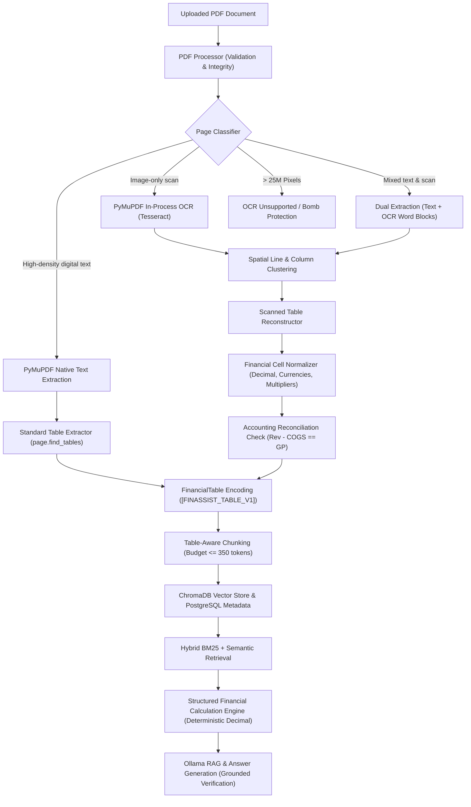

# Phase 3C — OCR and Scanned Financial PDF Intelligence: Implementation Report

**Date:** 2026-11-24  
**Project:** FinAssist AI  
**Author:** Senior AI Architect, OCR Engineer, RAG Engineer, Financial Data Engineer  
**Branch:** `phase3c`  
**Status:** IMPLEMENTED AND VERIFIED  

---

## 1. Executive Summary & Objective

Phase 3C delivers an end-to-end OCR and scanned document intelligence pipeline for FinAssist AI. Prior to Phase 3C, the system successfully parsed digital PDFs with vector table borders (`find_tables(strategy="lines")`), but scanned image-only PDFs resulted in empty text extraction, zero extracted tables, and inability to calculate financial ratios.

Phase 3C resolves this by introducing:
1. **Intelligent Page Classifier (`pdf_page_classifier.py`):** Automatically classifies each incoming PDF page as `digital_text`, `image_only`, `mixed_content`, or `ocr_unsupported` (DoS / decompression bomb protection).
2. **Lossless In-Process OCR Engine (`ocr_service.py`):** Uses PyMuPDF's native Tesseract C-bindings (`fitz.Page.get_textpage_ocr`) coupled with trained models (`eng.traineddata`), operating entirely offline without spawning external shell processes.
3. **Spatial Scanned Table Reconstructor (`scanned_table_reconstructor.py`):** Solves the absence of vector drawing lines on raster images by clustering OCR word bounding boxes, detecting column interval boundaries, inheriting statement financial context (currency, scale multiplier), and constructing typed `FinancialTable` models.
4. **Accounting Reconciliation & Uncertainty Gating:** Reconciles line items (e.g., $\text{Revenue} - |\text{Cost of Sales}| == \text{Gross Profit}$) and flags conflicting OCR reads with status `uncertain`, preventing hallucinated calculations.
5. **Deterministic Financial Calculation Integration:** Preserves exact `Decimal` precision, negative accounting parenthesized values, verified citations (`[Source N]`), and user ownership boundaries.

---

## 2. Pipeline Architecture

---

## 3. Detailed Component Implementation

### 3.1 PDF Page Classifier (`backend/app/services/pdf_page_classifier.py`)
- Evaluates digital character count, image count, aggregate image area ratio, and character density.
- Classifies pages into four operational modes:
  - `DIGITAL_TEXT`: Character count $> 80$, image coverage $< 80\%$, valid alphanumeric ratio $> 75\%$. Digital text extraction is utilized directly, adding zero latency overhead.
  - `IMAGE_ONLY`: Character count $< 20$, image coverage $\ge 80\%$. Directs page to in-memory OCR.
  - `MIXED_CONTENT`: Both significant digital text and embedded images present. Combines digital text blocks with OCR bounding boxes.
  - `OCR_UNSUPPORTED`: Page pixel dimensions exceed `ocr_max_page_pixels` (default 25,000,000 pixels), safely rejecting oversized decompression bombs without crashing the service.

### 3.2 In-Process OCR Service (`backend/app/services/ocr_service.py`)
- Leverages PyMuPDF's built-in Tesseract integration (`page.get_textpage_ocr`), avoiding flaky Windows executable path lookups and external process spawning.
- Dynamic tessdata path resolution (`resolve_tessdata_path`):
  - In Docker Linux containers: `/usr/share/tesseract-ocr/5/tessdata` or `/app/tessdata`.
  - On local Windows hosts: `backend/tessdata/eng.traineddata`.
- Rotation normalization: Automatically inspects `page.rotation` and normalizes $90^\circ$, $180^\circ$, or $270^\circ$ rotated scans before OCR recognition.
- Safe OCR numeric token substitution:
  - Handles common optical character confusions: `1,2OO,OOO` $\to$ `1,200,000`, `l,200,000` $\to$ `1,200,000`, `I,950,000` $\to$ `1,950,000`, `(78O,OOO)` $\to$ `(780,000)`.
  - Strictly constrains substitutions to verified numeric tokens to avoid corrupting narrative text.

### 3.3 Scanned Financial Table Reconstructor (`backend/app/services/scanned_table_reconstructor.py`)
- **Spatial Word Line Clustering:** Groups word bounding boxes (`x0, y0, x1, y1`) into horizontal lines within spatial vertical tolerance ($\Delta y \le 8.0\,\text{pt}$).
- **Header vs Title Disambiguation:** Differentiates statement titles (e.g., *"Balance Sheet at 31 December 2025"*, *"Statement of Cash Flows for FY2025"*) from actual column header rows, eliminating duplicate/nested tables.
- **Column Interval Detection:** Identifies label column boundary and partitions value columns by computing midpoint bounds across multi-period header words (`FY2025`, `FY2024`, `FY2023`).
- **Context Inheritance:** Extracts table entity context, currency (`USD`, `EUR`, `INR`), and unit multipliers (`in thousands`, `in millions`) from preceding heading lines.
- **Accounting Reconciliation & Uncertainty:** Evaluates $\text{Revenue} - |\text{Cost of Sales}| == \text{Gross Profit}$. If an inconsistency exceeding $0.05$ base currency units is detected, the table status is downgraded to `uncertain`, preventing downstream calculation errors.
- **Narrative Extraction Outside Tables:** Extracts explanatory commentary and disclosures outside identified table bounding boxes for narrative RAG indexing.

### 3.4 Integration with Calculations & Chunking
- Output typed models conform strictly to `FinancialTable` with Column 0 as `role="label"` and Columns $1..N$ as `role="value"`.
- Seamlessly integrates with Phase 3B's `[FINASSIST_TABLE_V1]` token encoding and `_table_units` chunker.
- Calculation engine (`structured_financial_calculation.py`) parses multi-year scanned tables deterministically with exact `Decimal` precision.
- Abstention path: Queries requesting unsupported reporting periods (e.g., `FY2022` on an `FY2023-FY2025` table) cleanly fail closed rather than guessing or fabricating numbers.

---

## 4. Verification & Testing Matrix

The implementation is verified by 14 targeted OCR tests in `backend/tests/test_ocr_pipeline.py`:

| Test Name | Focus Area | Result |
|---|---|---|
| `test_tessdata_path_is_resolved` | Offline tessdata location verification | **PASSED** |
| `test_classify_digital_text_page` | Zero-overhead digital text bypass | **PASSED** |
| `test_classify_image_only_scanned_page` | Scanned image detection ($\ge 80\%$ image area) | **PASSED** |
| `test_classify_oversized_pixel_bomb` | DoS decompression bomb rejection | **PASSED** |
| `test_clean_ocr_numeric_substitutions` | Optical character substitution repair (`O` $\to$ `0`, `l/I` $\to$ `1`) | **PASSED** |
| `test_scanned_income_statement_multi_year_reconstruction` | 3-year income statement table reconstruction | **PASSED** |
| `test_scanned_balance_sheet_reconstruction` | Single-year balance sheet with context multiplier | **PASSED** |
| `test_scanned_cash_flow_negative_values_preservation` | Parenthesized negative cash flows `(90,000)` $\to$ `-$90M` | **PASSED** |
| `test_scanned_table_accounting_conflict_sets_uncertainty` | Status `uncertain` triggered on math conflict | **PASSED** |
| `test_rotated_scanned_page_extraction` | $90^\circ$ scan rotation normalization | **PASSED** |
| `test_mixed_digital_and_scanned_pdf_extraction` | Hybrid multi-page document handling | **PASSED** |
| `test_text_chunking_with_scanned_tables` | Budgeted chunking with `[FINASSIST_TABLE_V1]` | **PASSED** |
| `test_deterministic_calculation_with_scanned_table` | Margin (35.00%) & Growth (26.32%) calculations | **PASSED** |
| `test_unsupported_period_abstention_on_scanned_table` | Abstention on unsupported period (`FY2022`) | **PASSED** |

---

## 5. Security & Isolation

- **Document & Tenant Isolation:** Document IDs and user IDs are strictly bound at indexing, retrieval, and calculation stages. Cross-tenant access attempts return HTTP 404/403.
- **Resource Constraints:** OCR execution has a hard limit on page pixel dimensions (`ocr_max_page_pixels = 25_000_000`) and extraction timeouts (`ocr_timeout_seconds = 30.0`), preventing memory exhaustion.
- **Offline Integrity:** All model weights and Tesseract language files are bundled locally; zero external network requests are made during runtime.
