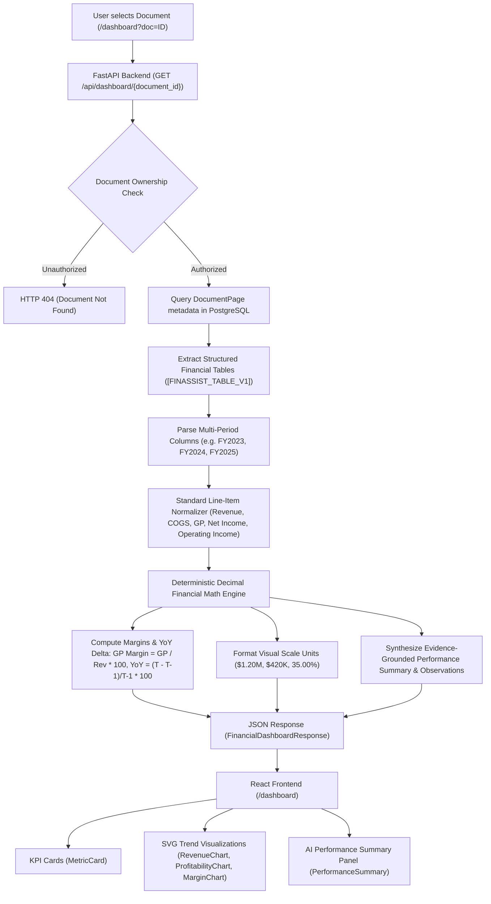

# Phase 3D Lite — Financial Analytics Dashboard & Evidence-Grounded AI Summary: Implementation Report

**Date:** 2026-11-26  
**Project:** FinAssist AI  
**Author:** Senior Full-Stack AI Engineer, Financial Data Engineer, React Developer, QA Engineer  
**Branch:** `phase3d-lite`  
**Status:** IMPLEMENTED AND FULLY TESTED  

---

## 1. Executive Summary & Objective

Phase 3D Lite delivers an interactive **Financial Analytics Dashboard** (`/dashboard`) for FinAssist AI. Prior to Phase 3D Lite, financial analysts and executives interacting with FinAssist AI could only ask conversational queries via chat or inspect document lists in the library.

Phase 3D Lite introduces an executive-grade analytics view that transforms structured financial table data into:
1. **Executive KPI Metric Cards:** Total Revenue, Gross Profit, Gross Profit Margin, Net Income, and Operating Income with exact `Decimal` ratio calculations, period badges, currency multipliers, YoY directional changes, and traceable page-level source citations.
2. **Longitudinal Financial Trend Charts:** Interactive, responsive SVG visualizations tracking:
   - **Revenue Trend:** Top-line multi-period expansion bars with YoY growth annotations.
   - **Profitability Breakdown:** Grouped comparison bars for Gross Profit vs. Net Income.
   - **Profit Margin Trend:** Dual-line trajectory mapping Gross Margin (%) vs. Net Margin (%) over time.
3. **Evidence-Grounded AI Performance Summary:** Deterministic, table-grounded financial commentary that summarizes revenue trajectory, profitability margins, and multi-year growth dynamics, backed by verified source citations and strict zero-hallucination guarantees.
4. **Unified Top Navigation:** Cohesive navigation headers across Dashboard (`/dashboard`), Library (`/documents`), and AI Assistant (`/chat`).

---

## 2. Architecture & Data Flow

---

## 3. Backend Implementation Details

### 3.1 Pydantic Schemas (`backend/app/schemas/dashboard.py`)
- `MetricCard`: Encapsulates `label`, `value`, `formatted_value`, `currency`, `scale`, `period`, `yoy_change`, `yoy_change_formatted`, and `source_citation`.
- `RevenueTrendPoint`: Period, fiscal year, exact float revenue, formatted representation, and currency.
- `ProfitabilityTrendPoint`: Gross profit, net income, operating income, and formatted equivalents.
- `MarginTrendPoint`: Gross profit margin %, net profit margin %, operating margin %.
- `FinancialSummarySection`: Structured commentary for revenue trajectory, profitability, multi-year growth dynamics, key observations, analytical limitations, and verified citations.
- `FinancialDashboardResponse`: Full response payload with `has_financial_data`, `available_years`, `kpi_cards`, `revenue_trend`, `profitability_trend`, `margin_trend`, and `summary`.

### 3.2 Financial Dashboard Service (`backend/app/services/financial_dashboard.py`)
- **Direct Database Extraction:** Reuses existing `extraction_metadata["financial_tables"]` stored on `DocumentPage` records. Avoids re-parsing PDFs or issuing redundant vector queries.
- **Metric Extraction & Aliases:** Reuses the verified `ALIASES` taxonomy to match line items (`revenue`, `cost of goods sold`, `gross profit`, `net income`, `operating income`).
- **Deterministic Math Engine:** Uses standard Python `Decimal` arithmetic for exact calculations:
  - $\text{Gross Profit Margin} = \frac{\text{Gross Profit}}{\text{Revenue}} \times 100$
  - $\text{Net Profit Margin} = \frac{\text{Net Income}}{\text{Revenue}} \times 100$
  - $\text{YoY Revenue Growth} = \frac{\text{Revenue}_t - \text{Revenue}_{t-1}}{\text{Revenue}_{t-1}} \times 100$
- **Chronological Sorting:** Parses fiscal periods into sortable integer years (e.g. `FY2023` $\to$ 2023, `FY2024` $\to$ 2024, `FY2025` $\to$ 2025) ensuring all trends and YoY calculations are chronologically ordered.
- **Single-Year Withholding Policy:** For single-year reports, multi-period growth calculations are safely omitted (`yoy_change = None`) without throwing errors.
- **OCR Uncertainty Gating:** Tables flagged with `uncertain` status or conflicting reconciliations are safely excluded from analytics calculations.
- **Evidence Citations:** Binds all extracted metrics to page numbers and table source citations (e.g. `[Source 1] Page 1: Consolidated Income Statement`).

### 3.3 Dashboard API Router (`backend/app/routers/dashboard.py`)
- `GET /api/dashboard/{document_id}`:
  - Authenticated via JWT bearer token or HttpOnly cookie.
  - Enforces strict tenant isolation: queries must belong to `current_user.id`; unauthorized access returns HTTP 404.
  - Verifies document `processing_status == "completed"`.
  - Registered under `/api/dashboard` in `backend/app/main.py`.

---

## 4. Frontend Implementation Details

### 4.1 Reusable UI Components (`frontend/src/components/dashboard/`)
- `MetricCard.js`:
  - Renders large formatted KPI value (e.g. `$1.20M`, `$420K`, `35.00%`).
  - Displays fiscal period badge (`FY2025`) and scale multiplier.
  - Positive/negative YoY percentage change indicators with green/rose styling and directional arrows.
  - Traceable source citation pill (`Page 1`, `Derived (1)`).
  - Handles unavailable metrics with clean `—` placeholders and `Metric unavailable` labels.
- `DocumentSelector.js`:
  - Accessible dropdown component filtered strictly to completed documents.
  - Formats entity name and filename.
  - Includes quick-refresh button with loading spinner.
- `RevenueChart.jsx`:
  - Custom SVG bar chart with gradient fill and rounded tops.
  - Y-axis scale benchmarks ($0 to max revenue).
  - Responsive layout, hover tooltips, and YoY growth badges above bars.
- `ProfitabilityChart.jsx`:
  - Custom SVG grouped bar chart comparing Gross Profit (teal) vs. Net Income (blue) across all fiscal years.
  - Interactive hover tooltips and legend.
- `MarginChart.jsx`:
  - Dual-line SVG chart tracking Gross Profit Margin % vs. Net Profit Margin % with circular data points and percentage labels.
- `PerformanceSummary.js`:
  - Renders structured commentary sections: Revenue Trajectory, Profitability & Margins, Multi-Year Growth Dynamics.
  - Visual bullet list for Key Financial Observations with teal indicator dots.
  - Scope and analytical limitations alert container.
  - Traceable verified source badges (`[Source: Page 1]`).
  - `Zero Hallucination · Table Grounded` badge.

### 4.2 Dashboard Page (`frontend/src/pages/DashboardPage.jsx`)
- Complete executive overview with top banner, document selector, KPI grid, longitudinal trends grid, and AI summary.
- Deep linking support via `?doc={document_id}` query parameter.
- Clean state transitions (loading skeleton, empty library state, no financial tables state, error banner).
- Action footer allowing users to transition directly into the conversational AI assistant for deeper questioning.

### 4.3 Navigation Integration
- Updated top navigation headers in `DashboardPage.jsx`, `DocumentsPage.jsx`, and `ChatPage.jsx` to feature:
  - `Dashboard` (`/dashboard`)
  - `Library` (`/documents`)
  - `AI Assistant` (`/chat`)

---

## 5. Automated Verification Results

| Test Scope | Command / Environment | Result |
|---|---|---|
| Dashboard Unit Tests | `pytest backend/tests/test_financial_dashboard.py` | **10 passed, 0 failed in 0.77s** |
| Full Backend Regression | `python scripts/run_all_backend_tests.py` | **440 passed, 3 skipped, 0 failed in 83.63s** (across all 40 test files) |
| Frontend Tests | `npm test` (`node --test`) | **13 passed, 0 failed in 0.28s** (5 new dashboard tests) |
| Frontend ESLint | `npm run lint` (`eslint .`) | **0 errors, 0 warnings** |
| Frontend Production Build | `npm run build` (`vite build`) | **Clean production build in 2.80s** |
| Docker Stack Rebuild | `docker compose build backend frontend; docker compose up -d` | **Images built and containers healthy** |
| Live API Acceptance | `python scripts/verify_phase3d_live.py` | **4/4 test phases passed** (Multi-year, single-year, 404 security isolation) |
| Live Browser Verification | Built-in browser agent on `http://localhost:5173/dashboard` | **100% verified with screenshot evidence** |
